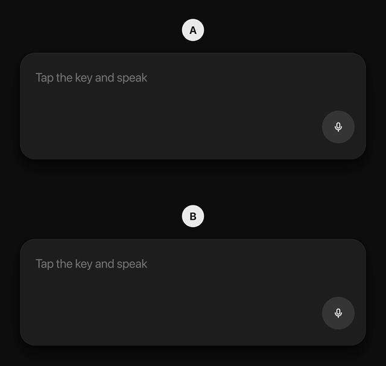

# `particle-dictation-ui`

[](./LICENSE)
[](./SKILL.md)
[-111111)](./examples)

<div align="center">



*Rendered live from our clean-room [`examples/react/demo.html`](./examples/react/demo.html) — **Variant A** (ASCII density ramp, top) vs. **Variant B** (dot-matrix bloom, bottom).*

</div>

An **Antigravity Skill** and verified cross-platform reference implementation for building a **60fps Voice-to-Text Particle Dictation Card** in **React / HTML5 Canvas** and **SwiftUI / CoreText / `AVAudioEngine` (macOS 14+ & iOS 17+, Swift 6)**.

Live vocal energy rises along a shared 2D mountain heightfield at the bottom edge, launches luminous particles along curved quadratic Bézier arcs toward the active text cursor, locks each incoming word onto a real `4×4` offscreen glyph bitmap, and crossfades through a soft Gaussian blur into crisp typography.

> **Attribution & Clean-Room Scope:** Inspired by `@sucodeee`'s Bluma **Murmur** showcase ([`bluma.design/c/murmur`](https://bluma.design/c/murmur), [X post `2125331380058091832`](https://x.com/sucodeee/status/2125331380058091832)). `Murmur` is a paid Bluma Pro component; this skill, its motion specification, and all bundled React and SwiftUI reference implementations are independent **clean-room reconstructions** derived from pixel/frame analysis of the public `1080×1080` @ 60fps showcase video.

---

## Variant A vs. Variant B

Both variants share identical card geometry (`878×270` scaled proportionally), dark surfaces (`#1E1E1E` card on `#0D0D0D` stage), 5-state machine (`idle` → `listening` → `thinking` → `completed` → `resetting`), 2D mountain heightfield, Bézier particle arcs, and `530ms` reset blur sweep. **Variant B is the recommended default.**

| Dimension | Variant A (`ascii` / `.ascii`) | Variant B (`dot-matrix` / `.dotMatrix`) — **Default** |
| :--- | :--- | :--- |
| **Bottom Waveform Grid** | `10×16` monospace 70-character Paul-Bourke density ramp over ambient mountain glow | `10×10` square grid with energy-weighted stochastic dithering across `.`, `:`, and glowing `8px ●` + radial bloom |
| **Flying Speech Particles** | Crisp `~4×4` white squares with velocity-aligned comet trails | Glowing `~4–5px` white circles with comet trails and tapered flight halos |
| **4×4 Glyph Assembly Mask** | Real offscreen `4×4` square pixel bitmap (`■`) before blur-to-sharp | Real offscreen `4×4` circular dot matrix (`•`) before blur-to-sharp |
| **60fps Canvas Pattern** | Pre-baked HiDPI 70-glyph ASCII strip atlas (`drawImage`, zero per-frame font raster churn) | Pre-baked `48×48` radial bloom sprite blitted in a second additive (`lighter`) pass (zero `ctx.shadowBlur`) |

---

## Quick Preview (Zero Build)

Open the standalone interactive React/Canvas A/B playground directly in your browser or via a local static server:

```bash
# macOS quick open
open examples/react/demo.html

# Or serve locally (recommended if testing live microphone capture)
python3 -m http.server 8000
# Visit http://localhost:8000/examples/react/demo.html
```

Useful URL flags for visual inspection and deterministic testing:
- `?variant=ab` (default stacked A/B comparison), `?variant=a`, or `?variant=b`
- `?t=2.50` — freeze playback deterministically at `2.50s`
- `?clean=1` — hide playground controls for clean visual diffing
- `?reduced-motion=1` — preview reduced-motion fallback mode

---

## Installation (Antigravity Skill)

Clone directly into your **workspace skills directory** (project-scoped, recommended for team repos) or your **global skills directory** (available across all workspaces):

### Workspace Install (Project-Specific)

```bash
mkdir -p .agents/skills
git clone https://github.com/Rea1Felix/particle-dictation-ui.git .agents/skills/particle-dictation-ui
```

### Global Install (Machine-Local)

```bash
mkdir -p ~/.gemini/config/skills
git clone https://github.com/Rea1Felix/particle-dictation-ui.git ~/.gemini/config/skills/particle-dictation-ui
```

Because `SKILL.md` sits at the repository root and matches the folder name `particle-dictation-ui`, Antigravity discovers it automatically on the next turn without extra setup.

---

## Repository Structure

```text
particle-dictation-ui/
├── SKILL.md                                    # Antigravity skill entrypoint, workflow & verified pitfalls
├── assets/
│   └── preview.gif                             # Live clean-room preview rendered from examples/react/demo.html
├── references/
│   ├── motion-spec.md                          # 1080p geometry, color tokens, 60fps timeline & waveform/arc math
│   └── audio-asr-integration.md                # Web Audio/SpeechRecognition, AVAudioEngine/vDSP & accessibility guide
├── examples/
│   ├── react/
│   │   ├── ParticleDictationCard.tsx           # Production React + HTML5 Canvas component & useMicrophoneDictation hook
│   │   └── demo.html                           # Zero-build interactive A/B comparison & live mic playground
│   └── swiftui/
│       └── ParticleDictationCard.swift         # Production Swift 6 SwiftUI + CoreText + AVAudioEngine/vDSP component
├── scripts/
│   └── verify_skill_examples.sh                # Automated frontmatter, link, Swift 6, TypeScript & demo.html verifier
├── LICENSE                                     # MIT License
└── README.md
```

Key documentation links:
- [Skill Entrypoint (`SKILL.md`)](./SKILL.md)
- [Motion, Geometry & Visual Specification](./references/motion-spec.md)
- [Audio, Streaming ASR & Accessibility Guide](./references/audio-asr-integration.md)
- [React Component (`ParticleDictationCard.tsx`)](./examples/react/ParticleDictationCard.tsx)
- [Interactive HTML5 Playground (`demo.html`)](./examples/react/demo.html)
- [SwiftUI Swift 6 Component (`ParticleDictationCard.swift`)](./examples/swiftui/ParticleDictationCard.swift)

---

## Verification

Run the bundled validation script from the repository root:

```bash
./scripts/verify_skill_examples.sh
```

The script validates:
1. `SKILL.md` YAML frontmatter (`name` matches directory name), all relative Markdown links across the repository, and zero leaked workspace paths or UUIDs.
2. Swift 6 strict typechecking (`-swift-version 6 -warnings-as-errors -parse-as-library -typecheck`) for both **macOS 14+ (`arm64-apple-macosx14.0`)** and **iOS 17+ Simulator (`arm64-apple-ios17.0-simulator`)** when Xcode / Swift SDKs are installed.
3. Strict TypeScript checking (`--strict --noUnusedLocals --noUnusedParameters --noEmit`) of `examples/react/ParticleDictationCard.tsx` when `tsc` and `@types/react` are available in the workspace or global npm.
4. Structural accessibility/debug markers and inline JavaScript syntax (`node --check`) of `examples/react/demo.html`.

---

## License

MIT License — Copyright (c) 2026 [Rea1Felix](https://github.com/Rea1Felix). See [LICENSE](./LICENSE).
